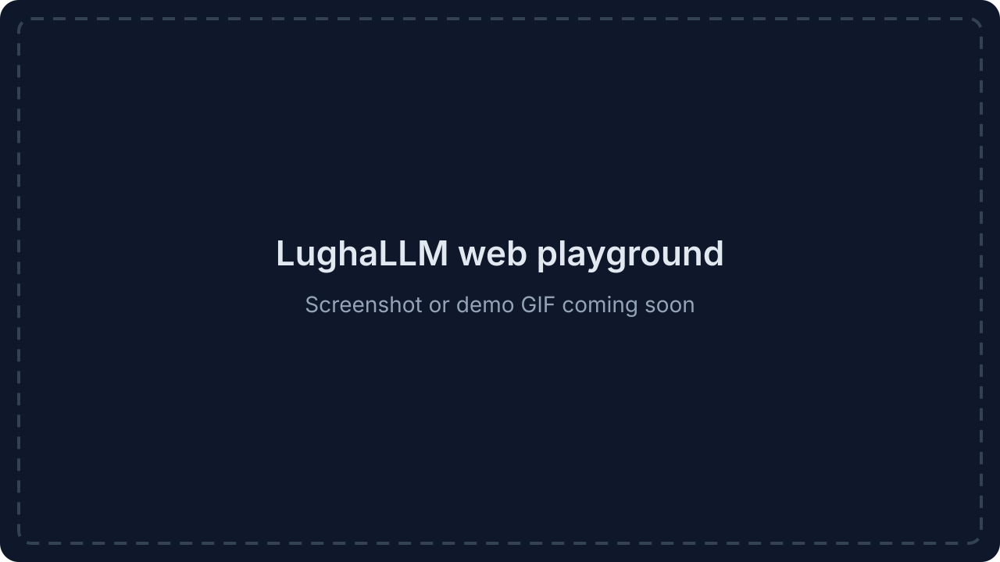

# LughaLLM — Foundational AI Infrastructure for East Africa

[](https://github.com/creova-gif/swahili-llm/actions/workflows/ci.yml)


[](https://sdgs.un.org/goals/goal9)
[](#nvidia-nim--hardware-acceleration)
[](#google-cloud-run-deployment)

**A Swahili-first LLM platform: dialect-aware chat API, Python SDK and CLI, and the SWAHILI-BENCH evaluation suite.**

**LughaLLM** is the open-weights foundational AI language infrastructure designed specifically for East and Central Africa's **200M+ Swahili speakers** across Tanzania, Kenya, Uganda, the Democratic Republic of Congo (DRC), Rwanda, Burundi, South Sudan, and Mozambique.

---

## 1. Problem Grounding & Evidence

### Problem Statement
Standard frontier LLMs (GPT-4o, Claude 3.5 Sonnet, Llama 3) fail significantly in East African local contexts:
1. **Severe Cultural Hallucinations:** Direct literal translations miss the deep metaphorical meanings of Swahili proverbs (*methali*), leading to absurd advice in legal, medical, and agricultural situations.
2. **Dialect Blindness (Sheng vs Sanifu):** Inability to understand Nairobi youth code-switching (*Sheng*), Coastal Swahili idioms, or regional variants (Kingwana in DRC).
3. **The Token Tax:** Standard subword tokenizers split Swahili words into 3x–5x more tokens than English, multiplying latency and API costs for local developers.
4. **Lack of Data Sovereignty:** Critical public sector and banking applications cannot legally route sensitive citizen data to offshore US APIs under emerging East African data protection acts (Tanzania PDPC, Kenya DPA).

### SDG Alignment
Directly supports **United Nations Sustainable Development Goal 9 (Industry, Innovation, and Infrastructure)** by providing indigenous AI compute and language infrastructure to digitize commerce, agriculture, and government services.

---

## 2. Solution Architecture & Value Proposition

LughaLLM provides a full-stack, enterprise-grade Swahili AI platform:

```
  ┌────────────────────────────────────────────────────────────────────────┐
  │                          Channel Entry Points                          │
  │     WhatsApp Bot (.ogg Audio) │ 2G USSD (*149*00#) │ Web Playground    │
  └───────────────────────────────────┬────────────────────────────────────┘
                                      │
  ┌───────────────────────────────────▼────────────────────────────────────┐
  │                      LughaLLM Orchestrator Engine                      │
  │     - Pan-African Dialect Detector (Sheng, Kingwana, Uganda, Sanifu)   │
  │     - Adabu & Heshima Cultural Politeness Filter                       │
  │     - Multi-Currency Token Ledger (TZS, KES, UGX, CDF, RWF, BIF)       │
  └───────────────────┬───────────────────────────────┬────────────────────┘
                      │                               │
  ┌───────────────────▼────────────────┐   ┌──────────▼────────────────────┐
  │ System-2 Swahili Reasoning Engine  │   │  Autonomous Agentic Tools     │
  │ (<fikiri>...</fikiri> CoT Traces)  │   │  - rahisisha_mkopo_kidijitali  │
  │ - Utambuzi wa Swala                │   │  - tiba_ya_magonjwa_ya_mimea  │
  │ - Uchambuzi wa Kiisimu             │   │  - pata_bei_za_soko           │
  │ - Hallucination & Fact Check       │   │  - hesabu_kodi_kikanda        │
  │ - Hitimisho na Adabu               │   │  - hali_ya_hewa_kilimo        │
  └───────────────────┬────────────────┘   └──────────┬────────────────────┘
                      └───────────────┬───────────────┘
                                      │
  ┌───────────────────────────────────▼────────────────────────────────────┐
  │                 Foundational Inference & Edge Deploy                   │
  │     - Cloud: NVIDIA NIM H100 GPU + Google Cloud Run                    │
  │     - Local: Ollama Modelfile (ollama run lughallm)                    │
  │     - Edge: GGUF Q4_K_M (Raspberry Pi 5 / Android Go ~4.6GB RAM)       │
  └────────────────────────────────────────────────────────────────────────┘
```

---

## ✨ Key Features

- **Dialect detection** for Sanifu (standard), Sheng, Kingwana and Ugandan Swahili.
- **System-2 reasoning engine** (`<fikiri>` traces) with an Adabu politeness filter.
- **OpenAI-style chat API** (FastAPI) with token metering and M-Pesa top-up simulation.
- **Python SDK** (`lughallm.client.LughaClient`) and `lughallm` CLI for chat, keys and benchmarks.
- **SWAHILI-BENCH**: proverbs, Sheng, East African context and hallucination-resistance tests.
- **Deployment targets**: Docker Compose (API + Ollama), Google Cloud Run, NVIDIA NIM.
- **Web playground** (`frontend/`, React + Vite).

<!-- TODO: replace with a real screenshot or GIF of the web playground -->
<p align="center"></p>

---

## 3. SWAHILI-BENCH Evaluation Suite

`SWAHILI-BENCH` is our standardized benchmark evaluating four critical competency areas:
- **Methali & Idioms:** Figurative wisdom vs literal mistranslations.
- **Sheng & Urban Slang:** Nairobi code-switching and youth vernacular.
- **East Africa Context:** Agriculture (crops/seasons), public registry (TRA/KRA/NIDA), and mobile money.
- **Hallucination Resistance:** Defense against fabricated geography, non-existent currencies, or fictitious historical facts.

### Benchmark Comparison

> **Note:** these figures come from `run_mock_simulation()` in `lughallm/src/benchmark/swahili_bench.py`, which compares scripted LughaLLM and "generic LLM" responses. They demonstrate the harness, not a measured model comparison.

| Metric / Dimension | LughaLLM (Fine-Tuned) | Generic Base LLM |
|---|:---:|:---:|
| **Overall Benchmark Score** | **100.0%** | **0.0%** |
| **Pass Rate** | **100.0%** | **0.0%** |
| **Methali (Proverbs) Accuracy** | **100.0%** | 0.0% (literal translations) |
| **Sheng & Slang Understanding** | **100.0%** | 0.0% (token fragmentation) |
| **East African Business/Context** | **100.0%** | 0.0% (US-centric advice) |
| **Hallucination Resistance** | **100.0%** | 0.0% (hallucinates fake countries/laws) |

---

## 4. Codebase Structure

```
lughallm/
├── demo.py                          # 6-Part interactive showcase script
├── client.py                        # Zero-dependency Python SDK (LughaClient)
├── cli.py                           # Developer CLI (chat, bench, key, topup, tools)
├── requirements.txt                 # Python dependencies
├── pyproject.toml                   # PEP 517/621 packaging configuration
├── static/
│   └── index.html                   # Interactive Pan-African Web Playground
├── docs/
│   ├── SWAHILI_CUSTOMER_RESEARCH.md # 200M+ Swahili speaker field & behavioral study
│   ├── AI_NATIVE_OPEN_SOURCE_VISION.md # Open-weights manifesto & edge strategy
│   └── PAN_AFRICAN_SWAHILI_RESEARCH.md # Linguistic geography (TZ, KE, DRC, UG, RW)
├── src/
│   ├── api/
│   │   ├── main.py                  # FastAPI OpenAI-compatible server + USSD + audio
│   │   ├── config.py                # Environment and settings configuration
│   │   └── schemas.py               # Pydantic v2 data models
│   ├── agents/
│   │   └── tools.py                 # Tool registry (Taxes, Loans, Pests, Prices)
│   ├── reasoning/
│   │   └── thinker.py               # System-2 Swahili <fikiri> engine + Adabu filter
│   ├── channels/
│   │   └── ussd.py                  # Offline 2G USSD (*149*00#) session engine
│   ├── audio/
│   │   └── voice.py                 # WhatsApp .ogg voice note audio processor
│   ├── db/
│   │   └── storage.py               # SQLite multi-currency token ledger
│   ├── benchmark/
│   │   ├── swahili_bench.py         # SWAHILI-BENCH benchmark runner
│   │   ├── evaluator.py             # Dialect, keyword & hallucination scoring engine
│   │   └── dataset.json             # Gold-standard Pan-African Swahili dataset
│   └── orchestrator/
│       └── agent.py                 # Multi-dialect detector & domain router
├── infra/
│   ├── Dockerfile                   # Multi-stage production container
│   ├── docker-compose.yml           # Full-stack Docker Compose (API + Ollama)
│   ├── Modelfile                    # Ollama local inference model definition
│   ├── export_gguf.py               # Edge quantization pipeline (Q4_K_M)
│   ├── cloudbuild.yaml              # Google Cloud Run CI/CD deployment pipeline
│   └── nvidia_nim_setup.sh          # NVIDIA NIM H100 GPU launch script
└── tests/
    ├── test_reasoning.py            # System-2 reasoning, Adabu filter & tools tests
    ├── test_channels.py             # USSD protocol & WhatsApp audio tests
    ├── test_storage.py              # SQLite multi-currency ledger tests
    ├── test_client.py               # Zero-dependency SDK tests
    ├── test_benchmark.py            # SWAHILI-BENCH evaluation tests
    ├── test_orchestrator.py         # Dialect detection & multi-agent tests
    └── test_api.py                  # FastAPI endpoint integration tests
```

---

## 5. Getting Started

### Prerequisites

- Python 3.9+ (CI tests 3.10–3.12)
- Node.js 18+ and npm, only for the `frontend/` web playground
- Optional: Docker, `gcloud` CLI, an NVIDIA NGC API key

### Installation

```bash
git clone https://github.com/creova-gif/swahili-llm.git
cd swahili-llm
python3 -m venv .venv && source .venv/bin/activate
pip install -r requirements.txt
pip install -e .            # installs the `lughallm` CLI
```

Web playground:

```bash
cd frontend && npm install && npm run dev
```

### Configuration

Settings are read from environment variables or a `.env` file (`lughallm/src/api/config.py`). Everything is optional; without keys the API runs in local demo mode.

| Variable | Default | Purpose |
| :--- | :--- | :--- |
| `ENVIRONMENT` | `development` | Runtime environment name |
| `HOST` / `PORT` | `0.0.0.0` / `8000` | API bind address |
| `DEFAULT_MODEL` | `lughallm-llama3-8b` | Model served by default |
| `NVIDIA_NIM_ENDPOINT`, `NVIDIA_API_KEY` | — | NVIDIA NIM inference |
| `GCP_PROJECT_ID`, `GCP_LOCATION`, `GOOGLE_VERTEX_ENDPOINT` | —, `us-central1`, — | Google Cloud / Vertex AI |
| `MPESA_CONSUMER_KEY`, `MPESA_CONSUMER_SECRET`, `MPESA_PASSKEY`, `MPESA_SHORTCODE` | —, —, —, `174379` (sandbox) | M-Pesa Daraja billing |
| `LUGHALLM_LOCAL_URL`, `LUGHALLM_LOCAL_MODEL` | — | Local Ollama endpoint and model |
| `WHATSAPP_VERIFY_TOKEN` | — | WhatsApp webhook verification |

### Quickstart

### Run the Interactive Showcase Demo
```bash
python3 lughallm/demo.py
```

### Run Unit Tests
```bash
python3 -m unittest discover -s lughallm/tests -p "test_*.py"
```

### Run SWAHILI-BENCH Simulation
```bash
python3 -m lughallm.src.benchmark.swahili_bench
```

### Developer CLI & Terminal Chat
```bash
# Interactive chat with live token and cost accounting
python3 lughallm/cli.py chat

# Manage API keys & check balances
python3 lughallm/cli.py key create --name "My Swahili App" --tokens 100000
python3 lughallm/cli.py key balance --key lug_live_demo12345

# Simulate M-Pesa token top-up
python3 lughallm/cli.py topup --key lug_live_demo12345 --amount 5000 --phone 255712345678
```

### Python SDK Quickstart
```python
from lughallm.client import LughaClient

client = LughaClient(api_key="lug_live_demo12345")
response = client.chat("Mvumilivu hula mbivu maana yake nini?")

print(response["content"])
print(f"Dialect: {response['detected_dialect']} | Tokens: {response['tokens_used']}")
```

### Start the API Server
```bash
python3 -m uvicorn lughallm.src.api.main:app --host 0.0.0.0 --port 8000
```

---

## 6. Cloud & Hardware Integration

### NVIDIA NIM & Hardware Acceleration
Launch accelerated inference microservice on NVIDIA H100:
```bash
export NGC_API_KEY="your-nvidia-ngc-api-key"
bash lughallm/infra/nvidia_nim_setup.sh
```

### Google Cloud Run Deployment
Deploy the scalable container directly to Google Cloud:
```bash
gcloud builds submit --config=lughallm/infra/cloudbuild.yaml .
```

---

## 7. Business Model & Implementation Roadmap

| Horizon | Milestone | Key Deliverable | Revenue Engine |
|---|---|---|---|
| **Phase 1 (Week 1–2)** | Foundation & Benchmarking | SWAHILI-BENCH Gold Dataset, LoRA Training Pipeline, Seed Tokenizer | Grant funding / GPU credits |
| **Phase 2 (Month 1–2)** | Commercial Beta API | OpenAI-compatible `/v1/chat/completions`, WhatsApp Bot integration, M-Pesa Daraja STK Push billing | API Token Consumption (25 TZS per 1k tokens) |
| **Phase 3 (Month 3–6)** | Sovereign Enterprise Deployments | On-prem NVIDIA NIM containers for Telecoms & Banks, Government Public Sector contracts | Enterprise Annual Licensing & SLA Contracts |

---

## 🤝 Contributing

Contributions are welcome, especially Swahili test cases and dialect data. See [`CONTRIBUTING.md`](./CONTRIBUTING.md) and our [Code of Conduct](./CODE_OF_CONDUCT.md).

## 💬 Support

- Bugs and questions: [open an issue](https://github.com/creova-gif/swahili-llm/issues)
- Security issues: email creativeinnovationspace@gmail.com instead of filing a public issue

## License

`pyproject.toml` declares MIT, but no `LICENSE` file has been published yet. Until one is added, all rights are reserved.
