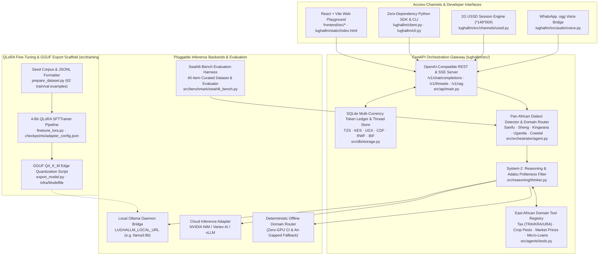

# 🌍 LughaLLM (`swahili-llm`)

**Low-Resource Swahili & Sheng AI Orchestration Gateway, Dialect Router, `<fikiri>` System-2 Reasoning Pipeline, USSD/Voice Channel Bridge & `Swahili-Bench` Evaluation Harness.**

[](https://github.com/creova-gif/swahili-llm/actions/workflows/ci.yml)
[](./LICENSE)
[](https://www.python.org/)
[](./lughallm/tests/)
[-orange.svg)](./lughallm/src/benchmark/dataset.json)

**LughaLLM** (`creova-gif/swahili-llm`) is an open-source language orchestration gateway, dialect router, and evaluation harness built for East and Central Africa's Swahili-speaking developer ecosystem (`Kiswahili Sanifu`, Nairobi `Sheng`, DRC `Kingwana`, Ugandan Swahili, and Coastal `Kiunguja`/`Kimvita`). It provides an OpenAI-compatible FastAPI gateway, a `<fikiri>` chain-of-thought reasoning pipeline, a multi-currency SQLite token ledger (`TZS`, `KES`, `UGX`, `CDF`, `RWF`, `BIF`), 2G USSD (`*149*00#`) and WhatsApp `.ogg` voice bridges, a React developer playground (`frontend/`), and the `Swahili-Bench` evaluation suite over local (`Ollama`) or cloud (`NVIDIA NIM` / `vLLM`) models.

---

## 1. System Architecture



---

## 2. Subsystem Implementation & Verification Status

In accordance with the CREOVA Engineering Honesty Standard, every component in this repository is explicitly categorized below so engineers and evaluators can distinguish between **verified runtime infrastructure** and **training scaffolds**:

| Subsystem | Module / Path | Status | Verification Notes |
| :--- | :--- | :--- | :--- |
| **Pan-African Dialect Detector & Multi-Agent Router** | [`lughallm/src/orchestrator/agent.py`](./lughallm/src/orchestrator/agent.py) | **Implemented & Verified in CI** | Classifies `kiswahili_sanifu`, `sheng_nairobi`, `kingwana_drc`, `swahili_uganda`, and `coastal_swahili`; tested in [`test_orchestrator.py`](./lughallm/tests/test_orchestrator.py). |
| **`<fikiri>` System-2 Reasoning & *Adabu* Politeness Engine** | [`lughallm/src/reasoning/thinker.py`](./lughallm/src/reasoning/thinker.py) | **Implemented & Verified in CI** | Generates structured Swahili CoT traces (`<fikiri>...</fikiri>`), strips robotic filler, and enforces cultural greeting etiquette; tested in [`test_reasoning.py`](./lughallm/tests/test_reasoning.py). |
| **FastAPI OpenAI-Compatible Gateway, SSE Streaming & Offline Codebase RAG** | [`lughallm/src/api/main.py`](./lughallm/src/api/main.py) | **Implemented & Verified in CI** | Serves `/v1/chat/completions`, multi-turn `/v1/threads`, `/v1/tools/execute`, `/v1/rag/search`, and `/v1/doctor`; tested in [`test_api.py`](./lughallm/tests/test_api.py). |
| **SQLite Multi-Currency Token Ledger (`TZS`, `KES`, `UGX`, `CDF`, `RWF`, `BIF`)** | [`lughallm/src/db/storage.py`](./lughallm/src/db/storage.py) | **Implemented & Verified in CI** | Parameterized SQLite persistence for API keys, token deductions, thread memory, and M-Pesa sandbox top-ups; tested in [`test_storage.py`](./lughallm/tests/test_storage.py). |
| **2G USSD (`*149*00#`) & WhatsApp `.ogg` Voice Channel Bridges** | [`lughallm/src/channels/ussd.py`](./lughallm/src/channels/ussd.py), [`lughallm/src/audio/voice.py`](./lughallm/src/audio/voice.py) | **Implemented & Verified in CI** | Stateful USSD menu pagination (`≤160 chars`) and `.ogg` header/duration validator + transcription bridge; tested in [`test_channels.py`](./lughallm/tests/test_channels.py). |
| **East African Domain Tool Registry** | [`lughallm/src/agents/tools.py`](./lughallm/src/agents/tools.py) | **Implemented & Verified in CI** | Deterministic calculators for regional tax brackets (`TRA`/`KRA`/`URA`/`RRA`), crop disease triage, commodity prices, and micro-loan amortization. |
| **`Swahili-Bench` Evaluation Harness & 40-Item Dataset** | [`lughallm/src/benchmark/swahili_bench.py`](./lughallm/src/benchmark/swahili_bench.py), [`dataset.json`](./lughallm/src/benchmark/dataset.json) | **Implemented & Verified in CI** | Evaluates *Methali* (proverbs), *Sheng*, East African statutory/agricultural context, and hallucination resistance; ships inside the installed wheel (`lughallm bench`). |
| **React + TypeScript + Vite Developer Playground** | [`frontend/`](./frontend/), [`lughallm/static/index.html`](./lughallm/static/index.html) | **Implemented & Verified** | Full chat UI with `<fikiri>` thinking drawer, thread sidebar, command palette, voice input, and token billing modal. |
| **Python SDK (`LughaClient`) & Developer CLI (`lughallm`)** | [`lughallm/client.py`](./lughallm/client.py), [`lughallm/cli.py`](./lughallm/cli.py) | **Implemented & Verified in CI** | Zero-dependency HTTP client and CLI (`serve`, `doctor`, `chat`, `bench`, `key`, `topup`, `tools`, `rag`). |
| **QLoRA Fine-Tuning, Dataset Prep & GGUF Export Pipeline** | [`lughallm/src/training/`](./lughallm/src/training/), [`lughallm/checkpoints/`](./lughallm/checkpoints/) | **LoRA Fine-Tuning Scaffold (Dry-Run Tested in CI)** | Contains PyTorch/PEFT/TRL 4-bit QLoRA training script (`finetune_lora.py`), 62 seed instruction pairs (`processed/train.jsonl` + `val.jsonl`), GGUF export script (`export_model.py`), and target PEFT config (`adapter_config.json`). **Note:** Multi-gigabyte fine-tuned `.safetensors` weights are not committed to git; running actual weight training requires a CUDA GPU with `torch`, `transformers`, `peft`, `trl`, and `bitsandbytes`. |

---

## 3. Engineering Decisions & Trade-Offs

Full context and consequences are recorded in [`docs/adr/0001-dialect-routing-and-fikiri-reasoning-gateway.md`](./docs/adr/0001-dialect-routing-and-fikiri-reasoning-gateway.md).

### 3.1 Gateway-First Dialect & Reasoning Orchestration vs. Monolithic Model Weights
Off-the-shelf foundation models frequently mistranslate Swahili idioms (*methali*) literally, misinterpret Nairobi *Sheng* or DRC *Kingwana*, and hallucinate statutory institutions across East African jurisdictions. Rather than coupling the platform to a single static weight checkpoint:
- **Lexical Dialect Routing (`DialectDetector`):** Classifies incoming utterances across five regional Swahili varieties before prompt construction so domain agents inject the appropriate regional tax authority (`TRA` in Tanzania, `KRA` in Kenya, `URA` in Uganda, `DGI` in DRC, `RRA` in Rwanda), currency, and register.
- **Explicit `<fikiri>` System-2 Delimitation (`SwahiliReasoningEngine`):** Separates internal chain-of-thought reasoning (`<fikiri>...</fikiri>`) from user-facing output, enabling the React frontend (`ThinkingDrawer.tsx`) to inspect reasoning steps while applying the *Adabu na Heshima* cultural politeness filter to the final response.

### 3.2 Hybrid Local (`Ollama`) + Cloud (`NVIDIA NIM`) + Deterministic Offline Fallback
To support air-gapped sovereign deployments alongside cloud-hosted SaaS:
- Setting `LUGHALLM_LOCAL_URL=http://localhost:11434` routes generation to a local `Ollama` daemon (`lughallm doctor` verifies daemon reachability).
- Setting `NVIDIA_NIM_ENDPOINT` and `NVIDIA_API_KEY` routes generation to accelerated `NVIDIA NIM` endpoints.
- When neither external backend is configured (such as in CI or offline feature-phone USSD testing), the gateway automatically falls back to its deterministic domain router so every API endpoint, CLI subcommand, and test suite executes reproducibly without a GPU.

### 3.3 Transparent Benchmarking (`Swahili-Bench`)
`lughallm/src/benchmark/swahili_bench.py` ships with a 40-item gold dataset (`lughallm/src/benchmark/dataset.json`) spanning four categories:
1. **Methali & Idioms:** Figurative meaning vs. literal word-for-word translation traps.
2. **Sheng & Urban Slang:** Nairobi code-switching and youth vernacular.
3. **East African Context:** Agriculture, mobile money (`M-Pesa`), and statutory agencies (`TRA`, `KRA`, `NIDA`).
4. **Hallucination Resistance:** Rejecting fabricated countries (e.g., *"Jamhuri ya Kilimanjaro"*), fake currencies, or fictitious laws.

> **Benchmark Honesty Note:** Calling `python3 -m lughallm.src.benchmark.swahili_bench` (or `lughallm bench`) in CI runs `run_mock_simulation()`, which verifies the scoring evaluator (`lughallm/src/benchmark/evaluator.py`) against deterministic reference outputs (`100.0%` vs `0.0%` baseline) without requiring live GPU inference. To benchmark an external model endpoint, pass its generation callback to `SwahiliBenchEvaluator`.

---

## 4. Quickstart & Verification

### Prerequisites
- **Python 3.10+** (tested in CI across Python `3.10`, `3.11`, and `3.12`)
- **Node.js 18+ & npm** *(optional, for the React frontend in `frontend/`)*

### 1. Clone & Install

```bash
git clone https://github.com/creova-gif/swahili-llm.git
cd swahili-llm
python3 -m venv .venv && source .venv/bin/activate
pip install -r requirements.txt
pip install -e .
cp .env.example .env
```

### 2. Run the Test Suite & `Swahili-Bench` Harness

```bash
# Run the full pytest suite (68 passed, 13 GPU-only tests skipped when torch/peft are absent)
pytest -q

# Run the stdlib unittest suite
python3 -m unittest discover -s lughallm/tests -p "test_*.py"

# Execute the Swahili-Bench evaluation harness
python3 -m lughallm.src.benchmark.swahili_bench

# Verify the installed CLI entrypoint
lughallm doctor
lughallm bench --model lughallm
```

### 3. Start the FastAPI Gateway & React Developer Playground

```bash
# Terminal 1: Start the FastAPI server on http://localhost:8000
lughallm serve --host 0.0.0.0 --port 8000

# Terminal 2: Start the React + Vite playground on http://localhost:5173
cd frontend
npm ci
npm run dev
```

### 4. Python SDK & CLI Examples

```python
from lughallm.client import LughaClient

client = LughaClient(api_key="lug_live_demo12345", base_url="http://localhost:8000")
response = client.chat("Mvumilivu hula mbivu maana yake nini?")

print(response["content"])
print(f"Dialect: {response['detected_dialect']} | Tokens: {response['tokens_used']}")
```

```bash
# Create an API key and inspect multi-currency token balances
lughallm key create --name "Nairobi AgriTech App" --tokens 100000
lughallm key balance --key lug_live_demo12345

# Search the repository offline using the built-in TF-IDF codebase RAG index
lughallm rag "fikiri reasoning trace"
```

### 5. QLoRA Fine-Tuning & GGUF Export Scaffold (`lughallm/src/training/`)

```bash
# 1. Prepare and validate the ChatML/Alpaca JSONL instruction splits
python3 -m lughallm.src.training.prepare_dataset

# 2. Run the QLoRA training pipeline (runs in --dry-run validation mode if CUDA/torch is absent)
python3 -m lughallm.src.training.finetune_lora --dry-run

# 3. Validate GGUF Q4_K_M export and Ollama Modelfile generation
python3 -m lughallm.src.training.export_model --dry-run
```

---

## 5. Configuration Reference

All settings are read from environment variables or `.env` via [`lughallm/src/api/config.py`](./lughallm/src/api/config.py) (see [`.env.example`](./.env.example)):

| Variable | Default | Purpose |
| :--- | :--- | :--- |
| `ENVIRONMENT` | `development` | Runtime environment (`development`, `staging`, `production`) |
| `HOST` / `PORT` | `0.0.0.0` / `8000` | FastAPI server bind address and port |
| `DEFAULT_MODEL` | `lughallm-llama3-8b` | Default model identifier in API responses |
| `LUGHALLM_LOCAL_URL` | *(unset)* | Local `Ollama` HTTP endpoint (e.g., `http://localhost:11434`) |
| `LUGHALLM_LOCAL_MODEL` | `llama3:8b` | Model tag requested from the local `Ollama` daemon |
| `NVIDIA_NIM_ENDPOINT` | *(unset)* | NVIDIA NIM OpenAI-compatible inference URL |
| `NVIDIA_API_KEY` | *(unset)* | NVIDIA NGC / NIM bearer API key |
| `GCP_PROJECT_ID` / `GOOGLE_VERTEX_ENDPOINT` | *(unset)* | Google Cloud / Vertex AI endpoint configuration |
| `MPESA_CONSUMER_KEY` / `MPESA_CONSUMER_SECRET` | *(unset)* | Safaricom / Vodacom M-Pesa Daraja API credentials |
| `MPESA_SHORTCODE` | `174379` | M-Pesa business shortcode (defaults to Daraja sandbox) |
| `WHATSAPP_VERIFY_TOKEN` | *(unset)* | Webhook verification token for WhatsApp audio messages |

---

## 6. Repository Structure

```text
swahili-llm/
├── .ai/project.yaml                   # Machine-readable stack & verification contract
├── .github/
│   ├── workflows/ci.yml               # Python 3.10–3.12 test, benchmark & packaging CI
│   └── dependabot.yml                 # Weekly grouped dependency updates (pip, npm, docker, actions)
├── AGENTS.md                          # AI coding agent engineering rules & honesty contract
├── CHANGELOG.md                       # Versioned release changelog
├── CODE_OF_CONDUCT.md                 # Contributor Covenant Code of Conduct
├── CONTRIBUTING.md                    # Contribution & pull request guidelines
├── LICENSE                            # MIT License
├── SECURITY.md                        # Vulnerability disclosure & security architecture
├── .env.example                       # Safe environment variable template
├── docs/
│   └── adr/                           # Architecture Decision Records (ADR-0001)
├── frontend/                          # React 18 + TypeScript + Tailwind CSS + Vite playground
│   ├── src/components/                # ChatStream, ThinkingDrawer, ThreadSidebar, BillingModal, VoiceInput
│   └── package.json                   # Frontend dependencies & scripts
└── lughallm/                          # Core Python package
    ├── cli.py                         # `lughallm` CLI entrypoint
    ├── client.py                      # Zero-dependency Python SDK (`LughaClient`)
    ├── demo.py                        # 6-part interactive showcase script
    ├── checkpoints/                   # PEFT LoRA adapter configuration target
    ├── docs/                          # Linguistic & regional customer research notes
    ├── infra/                         # Dockerfile, docker-compose, Modelfile, Cloud Build & NIM scripts
    ├── src/
    │   ├── api/                       # FastAPI application, auth, Pydantic schemas & config
    │   ├── agents/                    # East African domain tools (tax, agriculture, loans, market prices)
    │   ├── audio/                     # WhatsApp .ogg voice processor
    │   ├── benchmark/                 # Swahili-Bench runner, evaluator & 40-item dataset.json
    │   ├── channels/                  # 2G USSD (*149*00#) state machine
    │   ├── db/                        # SQLite multi-currency token ledger & thread store
    │   ├── orchestrator/              # Pan-African dialect detector & domain router
    │   ├── reasoning/                 # <fikiri> System-2 reasoning & Adabu cultural filter
    │   └── training/                  # QLoRA fine-tuning scaffold, seed JSONL corpus & GGUF exporter
    └── tests/                         # 9 test modules (68 passing tests)
```

---

## 7. Contributing, Security & License

- **Contributing:** See [`CONTRIBUTING.md`](./CONTRIBUTING.md) and [`CODE_OF_CONDUCT.md`](./CODE_OF_CONDUCT.md).
- **Security Policy:** See [`SECURITY.md`](./SECURITY.md).
- **License:** Distributed under the [MIT License](./LICENSE).
