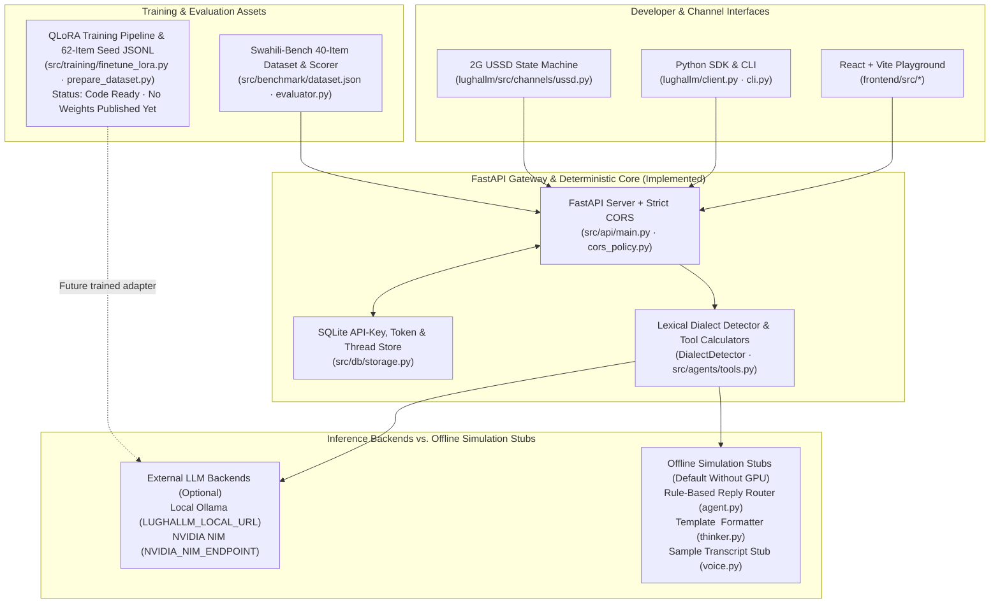

# LughaLLM — Research Scaffold & Evaluation Harness (`swahili-llm`)

**Open-source Swahili & Sheng evaluation dataset (`Swahili-Bench`), QLoRA fine-tuning scaffold, FastAPI dialect-routing gateway, SQLite token ledger, and offline channel simulation harness.**

[](https://github.com/creova-gif/swahili-llm/actions/workflows/ci.yml)
[](./LICENSE)
[](./pyproject.toml)


> [!IMPORTANT]
> **Research Scaffold & Weights Status:** **No trained model checkpoint weights (`.safetensors` / `.gguf`) or hosted model endpoints are published yet.**
> This repository provides the **training pipeline (`finetune_lora.py`)**, **seed instruction schema (`swahili_instructions_seed.jsonl`)**, **40-item `Swahili-Bench` evaluation harness (`dataset.json` + `evaluator.py`)**, and **application/gateway scaffolding** (`FastAPI`, `SQLite` ledger, `2G USSD` menu engine, `React` developer UI). Unless you connect a live `Ollama` (`LUGHALLM_LOCAL_URL`) or `NVIDIA NIM` (`NVIDIA_NIM_ENDPOINT` + `NVIDIA_API_KEY`) backend, the orchestrator, `<fikiri>` trace wrapper, and `.ogg` audio endpoint operate as **deterministic offline simulation stubs** for local integration testing.

---

## 1. Current Implementation Status (Real vs. Simulated vs. Planned)

Every module in `creova-gif/swahili-llm` is classified below by verified runtime behavior:

| Subsystem | Module / Path | Status | Exact Runtime Behavior |
| :--- | :--- | :--- | :--- |
| **QLoRA Fine-Tuning Script & Seed Dataset Schema** | [`lughallm/src/training/finetune_lora.py`](./lughallm/src/training/finetune_lora.py), [`prepare_dataset.py`](./lughallm/src/training/prepare_dataset.py), [`swahili_instructions_seed.jsonl`](./lughallm/src/training/swahili_instructions_seed.jsonl) | **Implemented & Verified (Training Scaffold)** | Real PyTorch / Hugging Face `peft` + `trl` (`SFTTrainer`) 4-bit QLoRA fine-tuning pipeline, target `adapter_config.json`, and 62-item ChatML/Alpaca JSONL seed dataset with CPU `--dry-run` validation. **No trained `.safetensors` or `.gguf` weights are published yet.** |
| **`Swahili-Bench` Dataset (40 Items) & Scorer** | [`lughallm/src/benchmark/dataset.json`](./lughallm/src/benchmark/dataset.json), [`evaluator.py`](./lughallm/src/benchmark/evaluator.py), [`swahili_bench.py`](./lughallm/src/benchmark/swahili_bench.py) | **Implemented & Verified** | 40 curated Swahili *methali* (proverbs), Nairobi *Sheng*, East African statutory/agricultural context, and hallucination-trap prompts. `run_against_endpoint()` scores live OpenAI-compatible endpoints via `httpx`; `run_mock_simulation()` is strictly a deterministic scorer self-test (not model inference). |
| **FastAPI Gateway, Strict CORS & SQLite Token Ledger** | [`lughallm/src/api/main.py`](./lughallm/src/api/main.py), [`cors_policy.py`](./lughallm/src/api/cors_policy.py), [`storage.py`](./lughallm/src/db/storage.py) | **Implemented & Verified** | OpenAI-compatible REST/SSE routes (`/v1/chat/completions`, `/v1/threads`, `/v1/keys/*`), origin-allowlisted CORS (never pairing `*` with credentials), and parameterized SQLite ledger for API keys, threads, and multi-currency token accounting (`TZS`, `KES`, `UGX`, `CDF`, `RWF`, `BIF`). |
| **Lexical Dialect Detector, Domain Calculators & 2G USSD Engine** | [`lughallm/src/orchestrator/agent.py`](./lughallm/src/orchestrator/agent.py) (`DialectDetector`), [`tools.py`](./lughallm/src/agents/tools.py), [`ussd.py`](./lughallm/src/channels/ussd.py) | **Implemented & Verified** | Lexical marker classifier (`kiswahili_sanifu`, `sheng_nairobi`, `kingwana_drc`, `swahili_uganda`, `coastal_swahili`), deterministic tax/loan/crop calculators, and `≤160`-char 2G USSD (`*149*00#`) session state machine. |
| **Python SDK (`LughaClient`), CLI (`lughallm`) & React UI** | [`lughallm/client.py`](./lughallm/client.py), [`lughallm/cli.py`](./lughallm/cli.py), [`frontend/`](./frontend/) | **Implemented & Verified** | Zero-dependency Python HTTP client, CLI (`serve`, `chat`, `bench`, `key`, `topup`, `tools`), and React 18 + TypeScript + Vite playground UI. |
| **Offline Orchestrator Fallback, `<fikiri>` Wrapper & Voice/M-Pesa Stubs** | [`lughallm/src/orchestrator/agent.py`](./lughallm/src/orchestrator/agent.py), [`thinker.py`](./lughallm/src/reasoning/thinker.py), [`voice.py`](./lughallm/src/audio/voice.py), `/v1/payments/mpesa/simulate` | **Simulated / Offline Stubs** | When no `Ollama` or `NVIDIA NIM` server is configured, `LughaOrchestrator` returns deterministic `if/elif` domain string responses; `SwahiliReasoningEngine` formats a static 5-step `<fikiri>` template; `SwahiliVoiceProcessor` returns canned Swahili/Sheng sample transcripts (no Whisper ASR wired yet); and `/v1/payments/mpesa/simulate` credits the local SQLite ledger without calling Safaricom/Vodacom Daraja. |
| **Trained LoRA / GGUF Checkpoints & Whisper ASR** | Hugging Face Hub / `lughallm/checkpoints/` | **Planned / Roadmap** | Full-corpus QLoRA training run on Llama-3.1-8B / Gemma-2, empirical `Swahili-Bench` baseline publication across open/frontier models, and Whisper-v3 Swahili ASR integration. |

---

## 2. Problem Statement & Research Motivation

General-purpose LLMs frequently struggle with East and Central African linguistic realities:
1. **Literal Mistranslation of *Methali* (Proverbs):** Figurative Kiswahili idioms are often translated word-for-word into English concepts rather than preserving pragmatic intent.
2. **Code-Switching & Regional Varieties:** Everyday developer and consumer queries blend `Kiswahili Sanifu`, Nairobi `Sheng`, DRC `Kingwana`, Ugandan Swahili, and coastal dialects alongside regional institutions (`TRA`, `KRA`, `URA`, `RRA`, `NIDA`).
3. **Evaluation Gap:** Low-resource African NLP projects need lightweight, reproducible evaluation datasets and OpenAI-compatible gateway harnesses that can be tested end-to-end on CPU laptops before committing GPU compute.

---

## 3. System Architecture



---

## 4. Engineering Decisions & Trade-Offs

Full context is recorded in [`docs/adr/0001-dialect-routing-and-fikiri-reasoning-gateway.md`](./docs/adr/0001-dialect-routing-and-fikiri-reasoning-gateway.md).

1. **Separating Evaluation & Gateway Infrastructure From Weight Publication:**
   - Shipping an OpenAI-compatible gateway, SQLite token ledger, dialect router, and 40-item `Swahili-Bench` scorer independently of multi-gigabyte `.safetensors` weights lets contributors iterate on dataset quality, dialect markers, and USSD UX in standard CPU environments (`Python 3.10–3.12`), while keeping `finetune_lora.py` ready for GPU training runs.
2. **Explicit Distinction Between Scorer Self-Tests and Model Benchmarks:**
   - `SwahiliBenchRunner` provides two distinct entry points:
     - `run_against_endpoint(endpoint_url, model_name, api_key)` — asynchronously queries a real OpenAI-compatible model server over HTTP and scores its completions against `dataset.json`.
     - `run_mock_simulation(model_profile)` — feeds synthetic reference vs. strawman strings through `SwahiliEvaluator` to verify keyword matching and hallucination-violation logic in zero-GPU CI. Mock simulation outputs are **unit-level harness checks**, never empirical model comparisons.
3. **Origin-Allowlisted CORS Without Wildcard Credentials (`cors_policy.py`):**
   - Browser-facing LLM gateways must never combine `allow_origins=["*"]` with `allow_credentials=True`. `resolve_cors_policy()` defaults to explicit localhost developer origins (`5173`, `3000`, `8000`) with credentials disabled unless explicitly configured via `CORS_ALLOWED_ORIGINS` and `CORS_ALLOW_CREDENTIALS`, stripping bare `"*"` wildcards unconditionally.

---

## 5. Prerequisites & Quickstart

### Prerequisites
- **Python 3.10+** (verified in CI across Python `3.10`, `3.11`, and `3.12`)
- **Node.js 18+ & npm** *(optional — for the `frontend/` React developer UI)*

### 1. Clean-Clone Setup

```bash
git clone https://github.com/creova-gif/swahili-llm.git
cd swahili-llm
python3 -m venv .venv
source .venv/bin/activate
pip install -r requirements.txt
pip install -e .
cp .env.example .env
```

### 2. Run Automated Tests & Harness Verification

```bash
# Run unit, storage, dialect, packaging, FastAPI, and CORS security tests
python3 -m unittest discover -s lughallm/tests -p "test_*.py" -v

# Verify dataset split preparation & QLoRA scaffold dry-run
python3 -m lughallm.src.training.prepare_dataset
python3 -m lughallm.src.training.finetune_lora --dry-run

# Run the Swahili-Bench scorer self-test (synthetic harness check)
python3 -m lughallm.src.benchmark.swahili_bench
```

### 3. Run the FastAPI Gateway & Optional React UI

```bash
# Terminal 1: Start FastAPI gateway on http://127.0.0.1:8000
python3 -m uvicorn lughallm.src.api.main:app --host 127.0.0.1 --port 8000

# Terminal 2 (Optional): Start React + Vite developer UI on http://localhost:5173
cd frontend
npm ci
npm run dev
```

To connect real local inference instead of the offline simulation router, run an [Ollama](https://ollama.com/) server and set `LUGHALLM_LOCAL_URL=http://localhost:11434` and `LUGHALLM_LOCAL_MODEL=llama3:8b` in `.env`.

### 4. Evaluate a Live OpenAI-Compatible Endpoint Against `Swahili-Bench`

```python
import asyncio
from lughallm.src.benchmark.swahili_bench import SwahiliBenchRunner

async def main() -> None:
    runner = SwahiliBenchRunner()
    report = await runner.run_against_endpoint(
        endpoint_url="http://127.0.0.1:8000/v1/chat/completions",
        model_name="llama3:8b",
        api_key="lug_live_demo12345",
    )
    print(f"Evaluated {report['total_items']} items | Pass rate: {report['pass_rate']:.1%}")

asyncio.run(main())
```

---

## 6. Configuration & Environment Variables

Configured via `.env` or environment variables (see [`.env.example`](./.env.example)):

| Variable | Default | Purpose |
| :--- | :--- | :--- |
| `ENVIRONMENT` | `development` | Runtime environment label |
| `HOST` / `PORT` | `0.0.0.0` / `8000` | FastAPI bind address and port |
| `CORS_ALLOWED_ORIGINS` | `http://localhost:5173,...` | Comma-separated explicit browser origins (`*` wildcard stripped) |
| `CORS_ALLOW_CREDENTIALS` | `false` | Whether cross-origin requests may include credentials |
| `LUGHALLM_LOCAL_URL` | *(unset)* | Optional local `Ollama` base URL (e.g., `http://localhost:11434`) |
| `LUGHALLM_LOCAL_MODEL` | `llama3:8b` | Model tag requested from `Ollama` |
| `NVIDIA_NIM_ENDPOINT` / `NVIDIA_API_KEY` | *(unset)* | Optional NVIDIA NIM OpenAI-compatible endpoint & API key |
| `WHATSAPP_VERIFY_TOKEN` | *(unset)* | Optional webhook challenge verification token |

---

## 7. Security Posture, Known Limitations & License

- **Security Policy:** See [`SECURITY.md`](./SECURITY.md) (`CORS` origin allowlisting, parameterized SQLite queries, non-root `UID 10001` Dockerfiles, and vulnerability disclosure via `security@creova.one`).
- **Known Limitations:**
  1. **No Published Model Checkpoints Yet:** `lughallm/checkpoints/lughallm-llama3-8b-lora/` currently contains only `adapter_config.json`; fine-tuned weights have not been trained or uploaded yet.
  2. **Simulated Audio & Offline Stubs:** `lughallm/src/audio/voice.py`, `thinker.py`, and `/v1/payments/mpesa/simulate` are local development stubs, not production speech-to-text, neural System-2 reasoning, or live mobile-money settlement integrations.
  3. **Seed Corpus Size:** `swahili_instructions_seed.jsonl` (`62` examples) and `dataset.json` (`40` benchmark prompts) are starter research datasets intended to be expanded prior to full fine-tuning.
- **Contributing & Governance:** See [`CONTRIBUTING.md`](./CONTRIBUTING.md), [`CODE_OF_CONDUCT.md`](./CODE_OF_CONDUCT.md), and [`AGENTS.md`](./AGENTS.md).
- **License:** Distributed under the [MIT License](./LICENSE).
